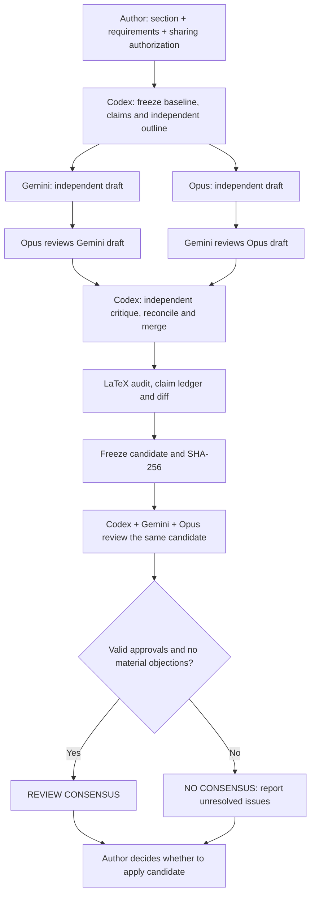

# Academic Writing Debate

**One Codex workspace. Two independent AI writing partners. One reviewable manuscript.**

An open-source agent skill for academic writing and adversarial manuscript review. Use Codex Desktop as the primary orchestrator to coordinate **Gemini 4 Carbon High** through Antigravity CLI and **Claude Opus** through Claude Code CLI. Instead of asking one model to polish a paper repeatedly, the skill instructs Codex to collect independent drafts, make the models critique each other, reconcile their objections, and review the same final LaTeX candidate.

[中文文档](README_zh.md) · [Skill instructions](SKILL.md) · [MIT License](LICENSE)

**Status:** v0.1 source code · Windows-first · Live Gemini bridge smoke test passed; Claude live smoke test blocked by account quota (HTTP 429). Full three-model manuscript workflow has not yet been verified end to end.

## What can it do?

| Feature | What the skill does |
| --- | --- |
| Independent academic writing | Gemini and Opus draft the same section from a shared, authorized evidence base without seeing each other's initial drafts. Codex first prepares its own outline and risk assessment. |
| Adversarial cross-review | Each external model reviews the other's actual draft, identifies concrete problems, assigns severity, and proposes corrections. Codex independently challenges both. |
| Scientific narrative | Improve clarity, structure, motivation, contribution statements, transitions, and academic English without inventing evidence or overstating results. |
| Technical precision | Review notation, theorem hypotheses, security assumptions, proof gaps, adversary capabilities, claim scope, and consistency with the source. |
| LaTeX safeguards | Preserve explicitly locked blocks exactly, detect changes to label sets, and flag newly introduced citation keys absent from approved bibliography files. |
| Claim and evidence tracking | Codex maintains a ledger of definitions, guarantees, experimental numbers, verified citations, limitations, and substantive changes requiring author approval. |
| Exact-version review | All three participants must explicitly approve the same frozen candidate identified by SHA-256. Changed text invalidates previous approvals. |
| Review artifacts | Save prompts, actual CLI responses, diagnostics, candidate LaTeX, a diff, and an issue ledger in a local review workspace. |
| Human-controlled editing | Original files remain unchanged during review. Applying a candidate requires a separate author instruction and a check that the original source has not changed. |
| Subscription-based CLI access | Use existing authenticated Antigravity and Claude Code sessions when supported by the accounts. The skill does not configure separate API billing or embed credentials. |

The workflow is suitable for research papers, thesis chapters, technical reports and reviewer-response drafts, especially in mathematics, computer science, cryptography and security. It is not limited to those fields.

## How it differs from ordinary AI polishing

A single model can improve the wording while accidentally changing a mathematical statement. Even two models may agree on an unsupported claim. This skill separates **writing, adversarial review, synthesis and version checking**.

| Participant | Main responsibility | Interface |
| --- | --- | --- |
| Codex | Sole orchestrator; independent technical review; issue resolution; candidate synthesis; final report | Codex Desktop |
| Gemini | English academic style, scientific narrative, clarity, independent writing and cross-review | Antigravity CLI (`agy`) |
| Claude Opus | Technical exposition, argument structure, independent writing and cross-review | Claude Code CLI (`claude`) |

These are assigned responsibilities, not benchmark claims that one model is objectively better at a task. All three are instructed to challenge assumptions and unsupported statements.

## Workflow



1. **Freeze inputs.** Record the section, target venue, length constraints, source hash and authorized context. Create a claim ledger and an independent Codex outline.
2. **Draft independently.** Both external models receive the same baseline and evidence, but not each other's opening draft. The real CLI responses are preserved.
3. **Cross-review and debate.** Review the actual opposing draft. Identify evidence, location, severity (BLOCKER / MAJOR / MINOR), proposed fixes and uncertainty. The default is two revision rounds per section, with a maximum of five.
4. **Synthesize.** Codex creates a separate candidate, diff and issue ledger, distinguishing editorial improvements from changes to scientific meaning. Run the limited LaTeX audit; compile only with author permission and trusted input.
5. **Review one version.** Freeze the candidate and calculate SHA-256. Gemini, Opus and Codex must each explicitly approve the same version. The bridge checks response records, matching digests and the exact candidate text in each external review prompt. Codex also reads the reasons and must not suppress material objections.
6. **Report.** Deliver REVIEW CONSENSUS or NO CONSENSUS, along with the candidate, diff, unresolved issues, and actual test/compile status. The author decides whether to apply changes.

Failures, quota exhaustion, invalid or missing responses, and unresolved material objections must not be converted into a successful consensus. No silent fallback to a different requested model.

## Example use cases

| Task | Intended output |
| --- | --- |
| Rewrite an Abstract or Introduction | Clearer motivation and contribution statements grounded in the actual results. |
| Improve a Related Work section | Better organization and comparison of supplied literature; flag missing evidence rather than invent references. |
| Review a cryptographic security proof | Independent objections, possible gaps and counterexamples, without silently changing assumptions or theorem statements. |
| Prepare an Evaluation section | Clearer presentation of supplied measurements, baselines and limitations. |
| Respond to reviewers | Evidence-backed draft replies and a list of unresolved requests. |
| Revise a full manuscript | Section-by-section review using a shared claim ledger, followed by a cross-section consistency review. |

## Requirements

- Windows with Codex Desktop able to run local commands.
- Python 3.9 or later (standard library only for the bridge).
- Antigravity CLI installed and authenticated (`agy`).
- Claude Code CLI installed and authenticated (`claude`).
- Account entitlements and available quotas for the selected models.

The requested default model IDs are `gemini-4-carbon-high` and `opus`. Actual model availability, quotas and billing depend on the provider and your account. Override with `AW_GEMINI_MODEL` and `AW_CLAUDE_MODEL` only after verifying access. The skill records the requested model; it does not independently attest the provider's model identity.

## Installation on Windows

### 1. Verify both CLI tools

Follow the official [Antigravity setup](https://antigravity.google/docs/getting-started?tab=cli) if needed. Open a fresh PowerShell, run `agy` to sign in, then check:

```powershell
agy --version
agy models
agy -p "Reply with exactly GEMINI_OK" --model gemini-4-carbon-high --output-format json

claude --version
claude auth status
claude -p "Reply with exactly CLAUDE_OK" --model opus --output-format json
```

### 2. Install the skill

Clone the repository or download and fully extract the ZIP:

```powershell
git clone https://github.com/Knarf-Z/academic-writing-debate.git
cd academic-writing-debate
py -3 install.py
```

Alternatively run `install.cmd` from the extracted directory. Running the Python installer directly makes any errors visible.

The installer copies the skill and custom Antigravity agent to:

```text
%USERPROFILE%\.agents\skills\academic-writing-debate\
%USERPROFILE%\.gemini\config\agents\academic-writing-reviewer\agent.md
```

The original `codex-claude-debate` skill is not overwritten. Existing differing files are not overwritten either; back them up before deliberately replacing them.

### 3. Verify the actual bridge

```powershell
py -3 "$HOME\.agents\skills\academic-writing-debate\scripts\bridge.py" check --provider gemini
py -3 "$HOME\.agents\skills\academic-writing-debate\scripts\bridge.py" check --provider claude
```

Expected on success:

```text
gemini: OK (requested gemini-4-carbon-high)
claude: OK (requested opus)
```

Restart Codex Desktop if necessary. Open the manuscript workspace. Before running a review, exclude `.academic-review/` in that project's `.gitignore` or local `.git/info/exclude`. The ignore file in this repository does not automatically protect another project.

## Usage in Codex

Select the manuscript project in Codex and ask:

```text
Use $academic-writing-debate to rewrite the Introduction.

Codex is the primary orchestrator. Have Gemini and Opus draft
independently, cross-review the actual drafts, and challenge
unsupported claims. Use at most two revision rounds.

Preserve the original mathematical definitions, security assumptions,
theorems, proofs, experiment numbers, and verified citation keys.
Produce a LaTeX candidate, diff, and unresolved issue list.
Do not change the original manuscript without my approval.
```

For a technical review without rewriting:

```text
Use $academic-writing-debate to review the proof of Theorem 2.
Ask the external models to look for missing assumptions,
invalid implications and counterexamples.
Do not edit the proof or invent supporting lemmas.
Report disagreements and the evidence needed to resolve them.
```

Codex must obtain explicit authorization to transmit the selected unpublished excerpts to both providers. Only authorize sharing if you have permission and the applicable research data policy allows it.

## LaTeX protection

Mark immutable regions in a review baseline copy (not the original file):

```latex
% AW-LOCK-BEGIN theorem-1
\begin{theorem}
The original theorem statement remains unchanged.
\end{theorem}
% AW-LOCK-END theorem-1
```

Run the helper against the proposed candidate:

```powershell
py -3 "$HOME\.agents\skills\academic-writing-debate\scripts\bridge.py" audit --original baseline.tex --candidate candidate.tex --bib references.bib
```

The helper checks exact locked blocks, label sets and new citation keys. It is a limited regular-expression audit, not a complete LaTeX parser, citation-verification service or mathematical proof checker. Unmarked text, changes in meaning and the relevance of existing references require substantive review.

## Deliverables and review trail

The skill instructs Codex to create a unique local review folder such as:

```text
.academic-review/<run-id>/
  baseline.tex
  candidate.tex
  ... independent drafts, cross-reviews and issue ledger
  ... diff and original-file fingerprint
  gemini-signoff.txt
  opus-signoff.txt
  codex-signoff.txt
  ... CLI response and diagnostic sidecars
```

For each external invocation, the bridge writes the response plus `.raw`, `.stderr`, `.meta.json` and `.prompt.txt` sidecars (where available). These record the prompt, raw response, requested provider/model, status and successful response fingerprints. They may contain private manuscript material; never commit them.

The signoff format is:

```text
VERDICT: AGREE
REVIEWED_SHA256: <candidate digest>
<substantive review reasoning>
```

`REVIEW CONSENSUS` indicates agreement on that specific candidate after the requested review process. It is not a cryptographic signature, formal proof, peer-reviewed publication, or guarantee of correctness. `NO CONSENSUS` is a valid and useful result.

## Implementation and repository layout

Codex orchestrates the workflow using [SKILL.md](SKILL.md). The Python bridge performs real external CLI calls and local mechanical checks; it is **not** a standalone autonomous paper-writing application.

```text
.
├── SKILL.md
├── README.md
├── README_zh.md
├── LICENSE
├── .gitignore
├── install.cmd
├── install.py
├── agents/
│   └── agent.md
├── scripts/
│   └── bridge.py
└── tests/
    └── test_bridge.py
```

Bridge commands: `check` (smoke test), `ask` (authorized provider call), `hash` (candidate fingerprint), `audit` (limited LaTeX safeguards), and `verify` (record and verdict checks). Run `py -3 scripts/bridge.py --help` for command options.

## Tests and limitations

Run the offline tests from the repository root:

```powershell
py -3 -m unittest discover -s tests -v
```

The test suite uses mocked CLI responses to exercise parsing, failure handling, model selection, LaTeX checks and candidate-version verification. Live tests require authenticated accounts.

- **Live status:** Gemini Carbon's direct CLI and bridge smoke tests succeeded on Windows. Claude's direct test returned HTTP 429 / usage limit reached. Full three-model operation remains unverified.
- **Quotas:** the skill uses multiple real model calls; long sections and repeated reviews may consume substantial quota. Use the smallest relevant context. There is no automatic quota-reset scheduling or resumption in v0.1.
- **Diagnostics:** `check` removes its temporary directory on exit. To retain logs, use `ask` with an authorized harmless prompt and a new output path. A CLI failure must not be reported as successful review.
- **Security:** the bridge uses temporary working directories and configures the external agents to operate without tools; these are application controls, not a verified OS sandbox. CLI versions, plugins, local configuration and provider data handling may affect actual behavior.
- **Privacy:** only share approved manuscript excerpts. Disabling optional data collection is not a guarantee of zero provider processing or retention. Never include credentials or unrelated sensitive material.
- **Scientific integrity:** AI-generated text and feedback must be checked by the authors. Follow the target venue's AI-use and disclosure rules. No autonomous submission, verified novelty claims, fabricated references, invented experimental results or automatic approval of proofs.

If the CLI cannot be found, set `AGY_BIN` or `CLAUDE_BIN` to its executable path. If the custom agent is not recognized, inspect `agy agents` and the installed CLI version. Do not disable security restrictions merely to make a call succeed.

## Related project

[Codex × Claude Code Debate](https://github.com/Knarf-Z/codex-claude-debate) focuses on adversarial protocol, architecture and implementation design review. Academic Writing Debate is a separate, manuscript-oriented skill with Gemini integration and academic-specific checks.

## License

[MIT License](LICENSE) · Copyright (c) 2026 Knarf-Z.
