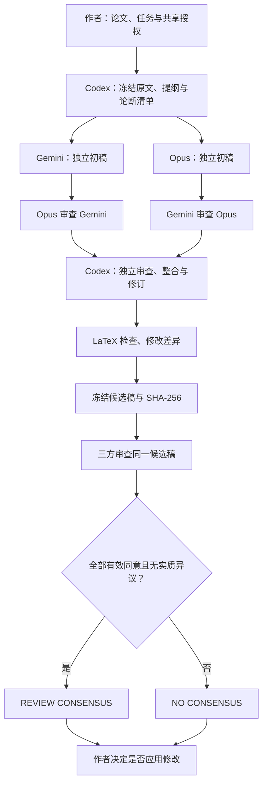

# Academic Writing Debate — 中文说明

**以 Codex 为唯一主控，让 Gemini 与 Claude Opus 独立写作、交叉审稿，再共同审查同一版本的论文。**

这是一个面向学术论文写作与对抗性审稿的开源 Agent Skill。Codex Desktop 通过真实的 Antigravity CLI 和 Claude Code CLI 调用外部模型，而不是模拟多个模型的回答。默认请求 Gemini 4 Carbon High 与 Claude Opus。

[English README](README.md) · [Skill 指令](SKILL.md) · [MIT License](LICENSE)

当前版本：v0.1 源码，优先支持 Windows。Gemini CLI 及 Python Bridge 的真实测试已经通过；Claude 的真实调用因账户额度耗尽（HTTP 429）未通过。尚未完成整个三模型论文工作流的端到端验证。

## 核心功能

| 功能 | 具体作用 |
| --- | --- |
| 独立写作 | Codex 先独立拟定提纲；Gemini 和 Opus 从相同的授权资料出发，各自撰写候选稿，初稿阶段不看对方的文本。 |
| 对抗性审稿 | Gemini 审查 Opus 的真实稿件，Opus 审查 Gemini 的真实稿件，Codex 独立质疑双方。指出具体问题、严重程度、依据和修正方法。 |
| 学术表达 | 改进英文表述、论文叙事、动机、贡献陈述和段落组织，不虚构事实。 |
| 技术审查 | 检查数学定义、符号、证明逻辑、威胁模型、安全假设、结论适用范围与实验表述。 |
| LaTeX 保护 | 对显式锁定区域、标签集合以及新增引用键执行机械检查，减少润色引起的理论变更。 |
| 事实与论断清单 | Codex 记录假设、保证、限制、数据、已核实的引用及需要作者批准的实质性修改。 |
| 精确版本确认 | 三方审查同一冻结候选稿，使用 SHA-256 标识版本。候选稿改变后必须重新确认。 |
| 可追溯记录 | 本地保存真实模型回复、提示词、调用状态、候选稿、修改差异与未解决问题。 |
| 作者控制 | 默认不改原始论文；只有作者另外批准后才可应用确切版本的修改。 |

适合数学、计算机、密码学、安全等技术论文，也可用于其他学科的学术写作。模型分工是工作流设计，并非经过专项基准测试得到的能力排名。

## 三模型架构

| 模型 | 角色 | 调用方式 |
| --- | --- | --- |
| Codex | 唯一主控、独立技术审稿、协调争议、整合候选稿 | Codex Desktop |
| Gemini Carbon | 独立写作、英文表达、叙事与交叉审稿 | Antigravity CLI (`agy`) |
| Claude Opus | 独立写作、技术论证、交叉审稿 | Claude Code CLI (`claude`) |

用户全程在 Codex 中发出指令，不需要分别手动向三个模型复制粘贴论文。Python Bridge 负责实际 CLI 调用和机械验证，Codex 按 Skill 指令组织流程；Python 本身并不是全自动论文写作应用。



默认每个章节进行最多两轮修订，可调整至最多五轮。存在尚未解决的重大问题时，不得强行达成共识。额度耗尽、调用失败或回复不符合要求，都应如实报告。

## 安装

需要 Windows、Codex Desktop、Python 3.9+、已登录的 Antigravity CLI 和 Claude Code CLI，以及所选模型的可用权限和额度。

首先验证模型连接：

```powershell
agy --version
agy models
agy -p "Reply with exactly GEMINI_OK" --model gemini-4-carbon-high --output-format json
claude auth status
claude -p "Reply with exactly CLAUDE_OK" --model opus --output-format json
```

尚未安装 Antigravity CLI 时，参照 [官方安装说明](https://antigravity.google/docs/getting-started?tab=cli)。

克隆仓库，或下载 ZIP 并完整解压：

```powershell
git clone https://github.com/Knarf-Z/academic-writing-debate.git
cd academic-writing-debate
py -3 install.py
```

也可双击 `install.cmd`。直接在 PowerShell 运行 Python 安装器便于查看报错。安装位置：

```text
%USERPROFILE%\.agents\skills\academic-writing-debate\
%USERPROFILE%\.gemini\config\agents\academic-writing-reviewer\agent.md
```

不会覆盖原有 codex-claude-debate Skill，也不会覆盖内容不同的已有文件。更新前应先备份冲突文件。

验证桥接：

```powershell
py -3 "$HOME\.agents\skills\academic-writing-debate\scripts\bridge.py" check --provider both
```

成功时应分别看到 gemini 和 claude 的 OK 状态。Skill 不配置新的 API Key 或单独的 API 账单；实际权限与收费取决于已有账户和服务商。可通过 `AW_GEMINI_MODEL` 和 `AW_CLAUDE_MODEL` 更改请求模型，不允许静默降级。

## 使用示例

重启 Codex（如需要），打开论文项目，在 Codex 中输入：

```text
使用 $academic-writing-debate 改写 Introduction。

Codex 作为唯一主控，让 Gemini Carbon 和 Claude Opus 独立写作、
交叉审稿，最多两轮修订。

严格保留原始理论、数学定义、安全假设、定理、实验数据和已核实的引用。
生成 LaTeX 候选稿、修改差异及未解决问题列表。
未经我批准不得修改原始论文。
```

只审查证明、不改写：

```text
使用 $academic-writing-debate 审查 Theorem 2 的证明。
让两个外部模型寻找反例、缺失假设、无效推导以及结论范围问题。
不要擅自修改证明或编造引理，报告真实分歧。
```

也可针对 Abstract、Related Work、Evaluation、Discussion 或审稿回复开展写作。全文任务应逐章处理，最后检查章节间术语、论断及假设一致性。

## LaTeX 与版本保护

在用于审稿的基线副本中标记不能修改的区域：

```latex
% AW-LOCK-BEGIN theorem-1
\begin{theorem}
The original theorem statement remains unchanged.
\end{theorem}
% AW-LOCK-END theorem-1
```

执行机械检查：

```powershell
py -3 "$HOME\.agents\skills\academic-writing-debate\scripts\bridge.py" audit --original baseline.tex --candidate candidate.tex --bib references.bib
```

检查锁定区域是否改变、LaTeX 标签集合是否改变，以及新增引用键是否在批准的 BibTeX 文件中。未标记内容的语义变化、引用真实性和相关性仍需要人工与模型实质审查。这不是完整 LaTeX 解析器、形式化证明器或文献核验服务。

最终冻结 `candidate.tex` 后，Codex、Gemini、Opus 分别对同一个 SHA-256 版本作出 `AGREE` 或 `REJECT` 判断，并说明理由。Python 检查外部调用记录、候选稿与哈希是否匹配，以及三方是否明确同意。哈希不是数字签名，三模型同意也不等于理论正确或论文达到会议录用标准。

## 输出及隐私

在论文项目的 `.academic-review/<run-id>/` 内保存候选 LaTeX、差异、论断清单、初稿、交叉审稿意见、三方最终判断和调用日志。每次外部调用会尽可能记录 `.raw`、`.stderr`、`.meta.json` 和 `.prompt.txt`。

开始前把 `.academic-review/` 加入论文项目自身的 `.gitignore` 或 `.git/info/exclude`。日志可能包含未发表的研究内容，不能直接上传。只有在获得授权、符合合作方和研究数据政策的情况下，才向两个服务商发送必要片段。不得发送密钥、登录凭证或无关敏感信息。

外部 Agent 使用临时工作目录，并配置为不使用工具。这属于应用层防护，不是经过验证的操作系统沙箱。请检查实际 CLI 版本和配置；遵守投稿 venue 对 AI 使用及披露的要求。

## 测试和已知限制

```powershell
py -3 -m unittest discover -s tests -v
```

离线测试使用模拟 CLI 响应，检查解析、错误处理、模型选择、LaTeX 审核与版本确认。真实模型调用需在已认证的环境执行。

- Gemini Carbon 真实 CLI 与 Bridge 已在 Windows 通过冒烟测试。
- Claude 的真实测试遇到使用额度限制，三模型端到端工作流尚未验证。
- v0.1 不会自动等待额度恢复或断点续跑。
- `check` 结束时会删除临时目录；需要保存诊断日志时，可使用 `ask` 命令发送已授权的无敏感信息测试提示，并指定新的输出路径。
- 若找不到 CLI，可设置 `AGY_BIN` 或 `CLAUDE_BIN`；不要为了排错关闭安全限制。

## 相关项目与许可证

[Codex × Claude Code Debate](https://github.com/Knarf-Z/codex-claude-debate) 面向技术方案设计与对抗性审查。本项目独立面向科研论文写作，加入 Gemini 和学术专项检查。

[MIT License](LICENSE)，Copyright (c) 2026 Knarf-Z。
